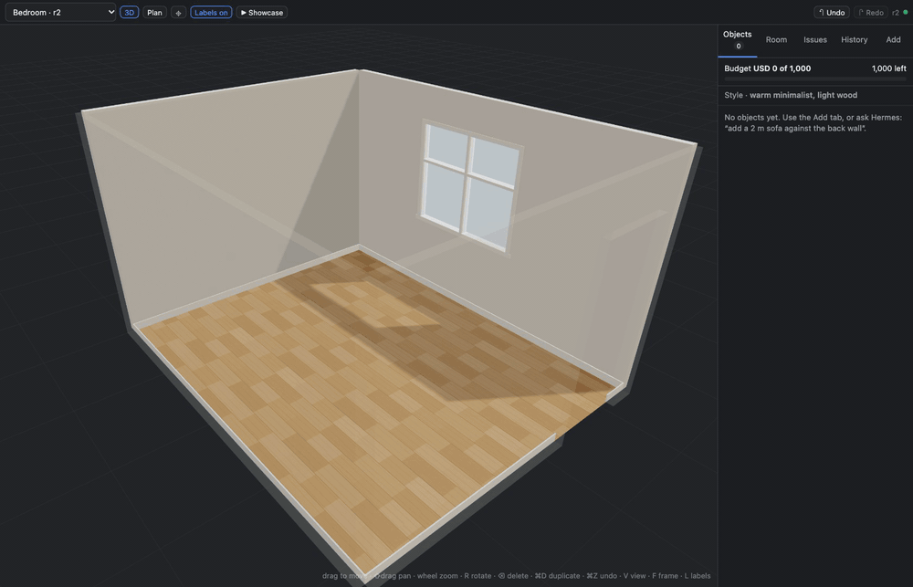
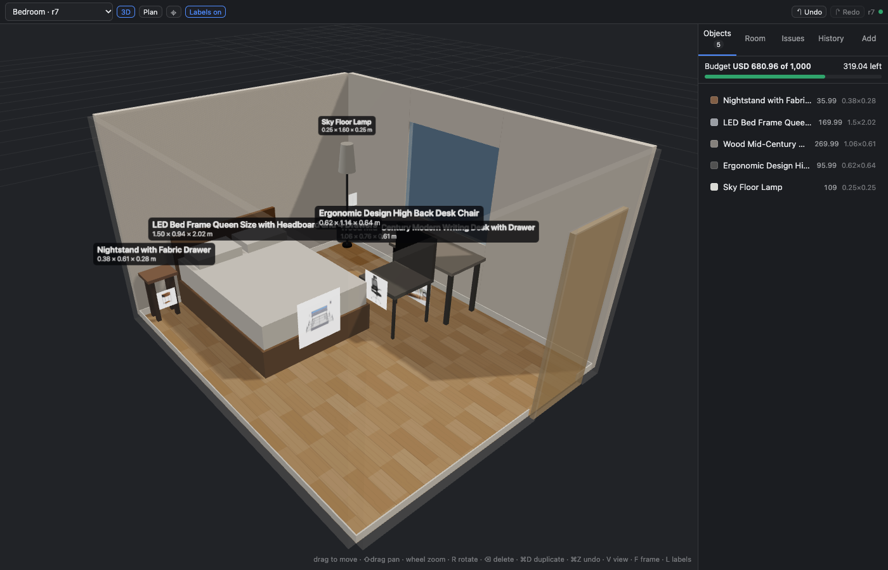
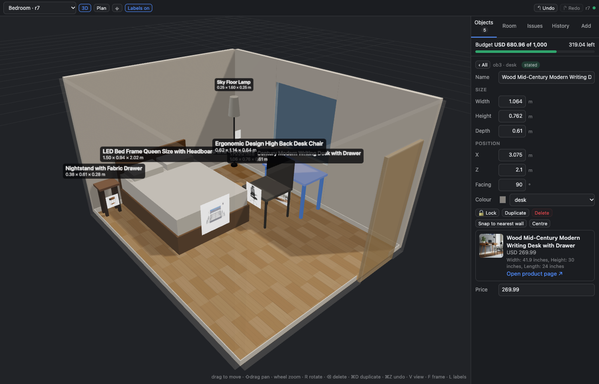
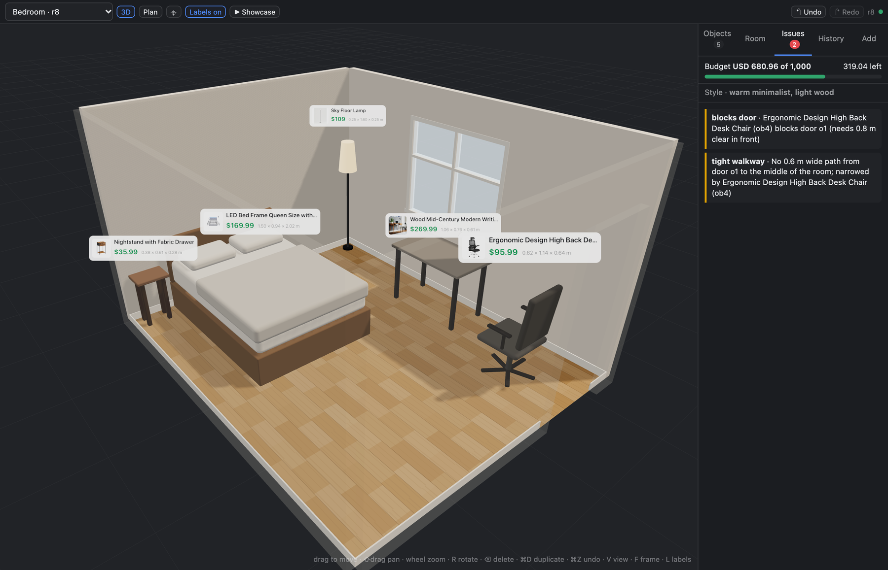
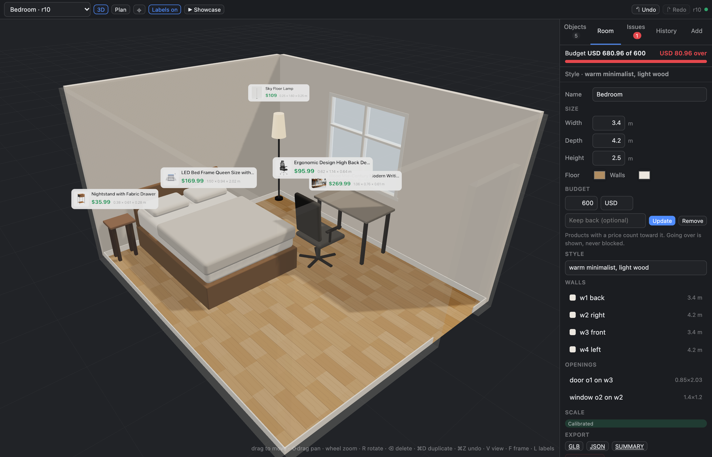
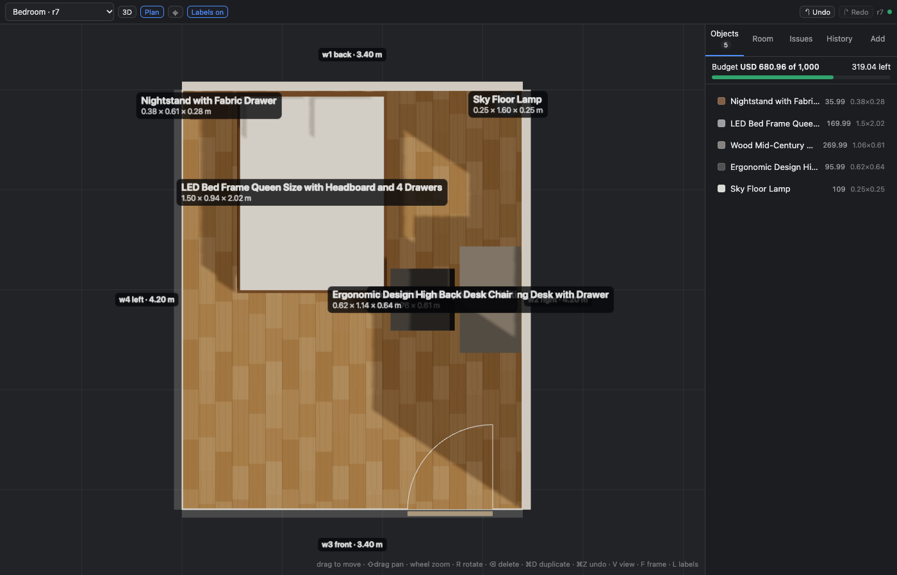

# Roomsmith — a Hermes Agent plugin

[](https://github.com/devSebb/roomsmith/actions/workflows/validate.yml) — on every push: engine tests on Python 3.11/3.14, editor typecheck and tests, bundles rebuilt and compared with the committed ones, and Hermes's own `plugins doctor --ci` and `plugins validate`. Run the same checks locally with `scripts/ci-local.sh`.

One 3D room that you and Hermes both edit. It tells you whether things fit and
what they cost. Drag the furniture by hand in an editor inside Hermes Desktop,
or tell Hermes what to change: both work on the same saved room, with undo, and
each sees what the other did. Start the room from a photo or from its
measurements. Give Hermes a budget and it furnishes the room with real products:
the plugin reads each product page, checks the size against your room and the
price against your budget, and shows the piece at true size.

**Status: 0.1.0 — built for the [Hermes Agent Plugin Hackathon](https://x.com/NousResearch/status/2118094256438936062) (Nous Research, 4–11 November 2026); see [Hackathon](#hackathon) below.**



*Real products arrive one at a time; the editor follows and the budget bar fills. (The editor, recorded in the development harness; the products were added through the plugin's tools by a script.)*



*Five real products, read from their shop pages, placed at true size. The budget bar is exact; the room above came to USD 680.96 of 1,000.*

| | |
|---|---|
|  |  |
| A real product: photo, title, price, printed size and link, read from the page | Drag a chair into the doorway and it says so, with the numbers |
|  |  |
| Over budget is shown, never blocked: the decision is yours | Plan view with wall lengths |

The editor is the same in the Hermes Desktop pane, the Desktop full page and the
`hermes dashboard` tab, in dark and [light](docs/screenshots/06-light-theme.png) themes.

## What it does

- **One room, two editors.** A live 3D editor (Hermes Desktop pane, or a tab in
  `hermes dashboard`) and eleven agent tools write the same saved room. Every edit
  is a numbered revision with undo; Hermes sees what you changed by hand, and
  you see what Hermes changed (it glides into place with a note), and when
  Hermes creates or opens another room the editor follows. Click a piece and say
  "would this fit by the window?": Hermes knows what you have selected.
- **Furnish to your budget.** Tell Hermes the amount. It finds real products
  with its own web search; `roomsmith_shortlist` reads each page, tests the size
  in the room and the price against what is left, and ranks them. Each piece
  arrives at true size and the editor's budget bar fills. Totals are exact. The
  budget is yours: the plugin reports when the room goes over and Hermes asks
  you; nothing is blocked and nothing is bought. A buffer is kept back only if
  you ask for one. Name a look ("warm minimalist, light wood") and Hermes shops
  with it; the room remembers it. Choosing what suits the look is Hermes's
  judgement. The plugin checks size and price, not taste.
- **Photo → draft room.** Hermes reads a photo and builds walls, door and window
  guesses, and the furniture it sees as sized boxes. Sizes are estimates until
  you give one real measurement (a wall, the door); then the whole room rescales.
- **Real products at true size.** Paste a link; the plugin reads the page's
  product data (title, price, photo, printed dimensions in cm/mm/m/in/ft) and
  puts a true-size stand-in in the room wearing the product's photo, with the
  name, price and link. No size on the page? It asks you, never guesses.
- **Fit checks by geometry, not guesswork.** Overlaps, things outside the room,
  blocked doors and windows, tight walkways, too-tall objects; "will this fit
  against that wall, with how much to spare", "where could it fit", "will it
  pass through the door".
- **Export** to GLB (opens in Blender, macOS Quick Look, most 3D tools), JSON
  (re-importable), or a text summary with sizes, prices, a total and product links. The editor's
  GLB is the room as drawn (shapes, floor, product tags); the agent's
  `roomsmith_export` writes a lighter box-per-object GLB.

## Install

```bash
hermes plugins install devSebb/roomsmith --enable   # or the catalog name: roomsmith
hermes plugins doctor roomsmith --ci                # optional: 11 tools, 1 hook, OK
```

Without `--enable` the installer asks `Enable 'roomsmith' now? [y/N]` and the
default is no; answer `y`, or run `hermes plugins enable roomsmith` afterwards.
The tools appear in the **next new chat**, not in one that was already open.
From Hermes Desktop you can also use
`hermes://plugin/install?repo=devSebb/roomsmith&enable=1`.

Then, depending on where you talk to Hermes:

- **Hermes Desktop:** *Settings → Plugins* lists two entries, **Roomsmith · on disk**
  (the editor) and **roomsmith** (the agent plugin). Switch the editor on: a
  **Roomsmith** entry appears in the sidebar, the room pane opens beside the chat,
  and a 🛋 chip in the status bar shows the active room. The full-page editor
  (sidebar entry / `⌘K` → *Open Roomsmith*) appears after the next app restart —
  Desktop registers pages at start-up.
- **CLI / `hermes dashboard`:** the tools work in any chat (`-t roomsmith` if you
  pin toolsets); the dashboard shows a **Roomsmith** tab with the same editor.

Requires Hermes Agent ≥ 0.21.0 (verified on 0.21.0 and 0.23.0). No API keys, no
accounts, no network access of its own (see *Privacy* below). Photo reading uses
whichever model your Hermes already runs; if that model cannot see images, the
plugin says so and builds the room from the sizes you give it instead.

## Try it

```
> make a 4.2 by 5 metre living room with a door on the left wall
> add a 2.1 m sofa against the back wall and a coffee table in front of it
> would a 1.6 m wide bookshelf fit on the right wall?
> would this fit where the sofa is? https://www.castlery.com/us/products/hamilton-sofa
> furnish this as a bedroom with a desk for under 1,000 dollars, warm minimalist, light wood
> swap the desk for a cheaper one
> /room
```

Then open the editor and drag things around; Hermes is told what you changed
and what you have selected the next time you speak to it.

With a photo: attach it in chat (if your model can see images, Hermes estimates
the room itself) or say `make a room from ~/Pictures/living.jpg`. Then:
`the back wall is 4.2 m` — and everything rescales.

## How it is built

```
plugin.yaml, __init__.py   agent half: 11 tools, /room, skill, awareness hook
rs_core/                   the engine: scene model, operations, validation,
                           fit checks, product-page reading, prices and budget,
                           images, SQLite store.
                           Standard library; Pillow (if present) for thumbnails.
rs_agent/                  Hermes-facing layer (tool schemas, handlers, photo)
dashboard/plugin_api.py    FastAPI routes under /api/plugins/roomsmith/
dashboard/dist/index.js    the editor as a dashboard tab (built)
desktop/plugin.js          the editor as a Hermes Desktop plugin (built)
web/                       editor source (TypeScript, three.js, React) + build
skills/room-design/        how the agent should work with a room
tests/                     pytest (engine, tools, backend, product pages, budget,
                           shortlist, hardening) — 211 tests
docs/                      architecture, compatibility record, screenshots
```

The tools and the editor's backend may run in different processes; the SQLite
file in `<hermes home>/plugin-data/roomsmith/` is the only shared state.
Writes are serialised with the database write lock and checked against the
revision they were derived from, so nobody's edit is ever silently lost.
[`docs/ARCHITECTURE.md`](docs/ARCHITECTURE.md) has the layers, the command
contract and the boundaries on one page.

### Build from source

The two built files are committed so an install needs no build step. To rebuild:

```bash
cd web && npm install && npm run build      # -> desktop/plugin.js, dashboard/dist/index.js
npm test                                    # editor math
cd .. && python3 -m venv .venv && .venv/bin/pip install pytest fastapi httpx pillow pyyaml
.venv/bin/python -m pytest                  # engine, tools, backend
```

The build runs the Hermes catalog's Desktop-surface lint and the 1 MB file
limit; it fails on any hit. `web/dev/` has a local harness (`server.py` +
headless-Chrome smoke scripts) that exercises the editor against the real
backend without Hermes.

## Conventions

Metres and degrees. `[width, height, depth]`: width across the front, depth
front-to-back. Walls `w1` back, `w2` right, `w3` front, `w4` left (as seen from
the camera that took the photo). "Left/right on a wall" are as seen from inside
the room facing that wall.

## Privacy and safety

- **Network:** the plugin makes exactly two kinds of request, both only for a
  product link you pasted or that Hermes passed in while furnishing: one GET to that URL (plus, for Shopify stores, the store's
  public product JSON next to it) and one GET for the product's main image, which
  is shrunk to a small thumbnail and kept in the room's data. Plain `User-Agent:
  Roomsmith/0.1`, no cookies, no retries against sites that refuse. Only public
  addresses are contacted: the host, and the host of every redirect, must resolve
  to public IPs (no localhost, private ranges or link-local), and responses are
  capped at 8 MB. Requests are bounded: at most 80 per 10 minutes and 12 per
  shop per minute; a page that read is reused for a day and a shop that refused is
  not asked again for half an hour. The plugin does not search the web (Hermes
  does, with your own search tool) and follows no links inside pages. Only the
  title, size line and price from a page reach the model, cleaned and
  length-capped; never page text. Photos you
  choose go to your configured Hermes model through Hermes's own model access;
  nothing else leaves your machine.
- **Files:** reads only the image files you name or upload; writes only inside
  `<hermes home>/plugin-data/roomsmith/` (exports go to its `exports/` folder and
  the tool returns the path; the editor's Export button downloads instead).
- **Money:** the plugin has no payment or account code and never buys or
  reserves anything. A price is only what a page printed or you typed. It does
  not convert currencies: a product priced in another currency, or with no
  readable price, is listed and left out of the total, and it says so.
- **No** shell commands, background processes, telemetry, credentials, or
  self-update.

## Known limitations (0.1)

- Photos give a *draft*: one photo shows two or three walls; the fourth wall and
  anything behind the camera are guesses. Calibrate (one real measurement) before
  trusting sizes — the editor shows a **Draft** badge until you do.
- Photo reading needs a model that accepts images. Otherwise the tool reports
  which fallback it took and asks for the room's measurements.
- HEIC photos are not read yet; export as JPEG/PNG first.
- Rooms are polygons in the data model but the editor resizes rectangles only.
- Product pages: the plugin reads structured data (schema.org Product, Shopify
  product JSON, OpenGraph), the visible text and the spec text modern stores keep
  in inline scripts. Read correctly live (size, price, photo; 10 Nov 2026):
  VASAGLE/SONGMICS, Nathan James, Brightech, Simpli Home, Walker Edison, Branch,
  Castlery, Poly & Bark, Sixpenny, Albany Park. A few pages read a wrong size or
  the default variant's price; check the stand-in's size and price against the
  page before you buy (`scripts/survey-stores.py` prints what the plugin reads
  from any list of links). Sites behind bot checks (Article, Wayfair-style
  WAFs, rate limiters) return an error that says so and Hermes asks you for the
  printed size. The plugin never invents a size; when a page prints only a
  footprint (desk tops) the category's usual height is used and said.
- Furnishing to a budget needs a web search tool in your Hermes for finding
  products; without one, paste a few links per piece. Prices are as read at that
  moment. There is no currency conversion.
- Hermes Desktop: the full-page editor needs one app restart after enabling; the
  Desktop's own right-click menu owns right-click on the canvas (pan with ⇧-drag
  or the middle button).

## Hackathon

Entry for the **Hermes Agent Plugin Hackathon** run by Nous Research:

- Announcement: <https://x.com/NousResearch/status/2118094256438936062> (4 Nov 2026) — 7 days, deadline **Wed 11 Nov 2026, 5 PM EST**; judged on usefulness, reliability, polish and creativity, favouring plugins that do more than a prompt or a skill could.
- Entry = a pull request adding `plugin-catalog/roomsmith.yaml` to [NousResearch/hermes-agent](https://github.com/NousResearch/hermes-agent) ([submission guide](https://hermes-agent.nousresearch.com/docs/developer-guide/plugins/catalog-submission)) + a demo video under 90 s posted on X tagging @NousResearch + both links through the [entry form](https://form.typeform.com/to/FwJLvOln).
- Catalog entry: [`catalog/roomsmith.yaml`](catalog/roomsmith.yaml); how it is built: [`docs/ARCHITECTURE.md`](docs/ARCHITECTURE.md); what was verified where: [`docs/compat.md`](docs/compat.md).

## Licence

MIT. The built editor bundles three.js (MIT); see `THIRD_PARTY_NOTICES.md`.
