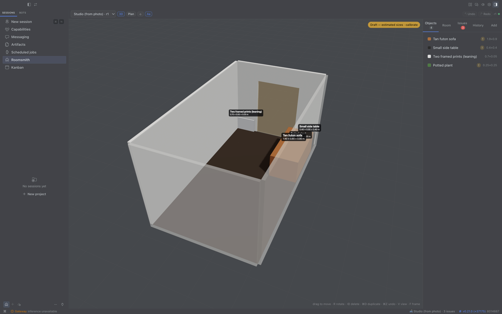
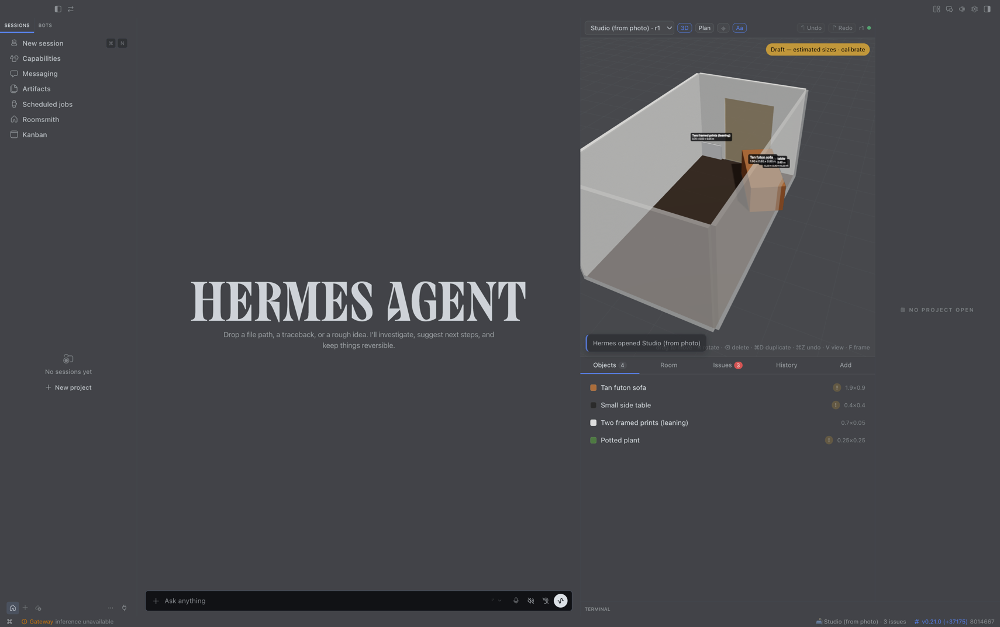

# Roomsmith — a Hermes Agent plugin

[](https://github.com/devSebb/roomsmith/actions/workflows/validate.yml) — engine tests on Python 3.11/3.14, editor tests, and Hermes's own `plugins doctor --ci` + `plugins validate` on every push.

Turn a photo of a room into an editable 3D room. Move the furniture by hand in
the editor or by talking to Hermes — both edit the same room, with undo. Paste a
product link and it appears at its true size, so you can see whether it fits
before you buy.

**Status: 0.1.0, in development for the Hermes Agent Plugin Hackathon.**



*Hermes read a photo and built this room; the editor opened it the moment the tool finished (below, as the pane beside the chat).*



## What it does

- **Photo → draft room.** Hermes reads a photo and builds walls, door and window
  guesses, and the furniture it sees as sized boxes. Sizes are estimates until
  you give one real measurement (a wall, the door); then the whole room rescales.
- **One room, two editors.** A live 3D editor (Hermes Desktop pane, or a tab in
  `hermes dashboard`) and nine agent tools write the same saved room. Every edit
  is a numbered revision with undo; Hermes sees what you changed by hand, and
  you see what Hermes changed (it glides into place with a note), and when
  Hermes creates or opens another room the editor follows.
- **Real products at true size.** Give Hermes a link; it reads the page with its
  own web tools and the plugin parses the dimensions (cm, mm, m, inches, feet)
  into a stand-in box with the product name, price and link.
- **Fit checks by geometry, not guesswork.** Overlaps, things outside the room,
  blocked doors and windows, tight walkways, too-tall objects; "will this fit
  against that wall, with how much to spare", "where could it fit", "will it
  pass through the door".
- **Export** to GLB (opens in Blender, macOS Quick Look, most 3D tools), JSON
  (re-importable), or a text summary with sizes and product links.

## Install

```bash
hermes plugins install devSebb/roomsmith      # from the catalog / GitHub
hermes plugins enable roomsmith               # the agent half
```

- **Desktop:** Hermes Desktop lists the plugin under **Settings → Plugins**;
  switch it on to get the Roomsmith pane, page and palette command.
- **Dashboard:** `hermes dashboard` shows a **Roomsmith** tab once the plugin
  is enabled.

Requires Hermes Agent ≥ 0.21.0. No API keys, no accounts, no network access of
its own (see *Privacy* below).

## Try it

```
> make a 4.2 by 5 metre living room with a door on the left wall
> add a 2.1 m sofa against the back wall and a coffee table in front of it
> would a 1.6 m wide bookshelf fit on the right wall?
> https://www.example-shop.com/kivik-sofa — does this fit where the sofa is?
> /room
```

Then open the editor and drag things around; Hermes is told what you changed
the next time you speak to it.

With a photo: attach it in chat (if your model can see images, Hermes estimates
the room itself) or say `make a room from ~/Pictures/living.jpg`. Then:
`the back wall is 4.2 m` — and everything rescales.

## How it is built

```
plugin.yaml, __init__.py   agent half: 9 tools, /room, skill, awareness hook
rs_core/                   the engine: scene model, operations, validation,
                           fit checks, SQLite store. Standard library only.
rs_agent/                  Hermes-facing layer (tool schemas, handlers, photo)
dashboard/plugin_api.py    FastAPI routes under /api/plugins/roomsmith/
dashboard/dist/index.js    the editor as a dashboard tab (built)
desktop/plugin.js          the editor as a Hermes Desktop plugin (built)
web/                       editor source (TypeScript, three.js, React) + build
skills/room-design/        how the agent should work with a room
tests/                     pytest (engine, tools, backend) — 81 tests
docs/                      plan, compatibility record, screenshots
```

The tools and the editor's backend may run in different processes; the SQLite
file in `<hermes home>/plugin-data/roomsmith/` is the only shared state.
Writes are serialised with the database write lock and checked against the
revision they were derived from, so nobody's edit is ever silently lost.

### Build from source

The two built files are committed so an install needs no build step. To rebuild:

```bash
cd web && npm install && npm run build      # -> desktop/plugin.js, dashboard/dist/index.js
npm test                                    # editor math
cd .. && python3 -m venv .venv && .venv/bin/pip install pytest fastapi httpx
.venv/bin/python -m pytest                  # engine, tools, backend
```

The build runs the Hermes catalog's Desktop-surface lint and the 1 MB file
limit; it fails on any hit. `web/dev/` has a local harness (`server.py` +
headless-Chrome smoke scripts) that exercises the editor against the real
backend without Hermes.

## Conventions

Metres and degrees. `[width, height, depth]`: width across the front, depth
front-to-back. Walls `w1` back, `w2` right, `w3` front, `w4` left (as seen from
the camera that took the photo). "Left/right on a wall" are as seen from inside
the room facing that wall.

## Privacy and safety

- **Network:** the plugin makes no network requests of its own. Photos you choose
  go to your configured Hermes model through Hermes's own model access. Product
  pages are read by Hermes's web tools, not by the plugin. The editor may load a
  product image from the address Hermes supplied.
- **Files:** reads only the image files you name or upload; writes only inside
  `<hermes home>/plugin-data/roomsmith/` and to export paths you ask for.
- **No** shell commands, background processes, telemetry, credentials, or
  self-update.

## Known limitations (0.1)

- Photos give a *draft*: one photo shows two or three walls; the fourth wall and
  anything behind the camera are guesses. Calibrate before trusting sizes.
- HEIC photos are not read yet; export as JPEG first.
- Rooms are polygons in the data model but the editor resizes rectangles only.
- Furniture is boxes and cylinders, not 3D product models.

## Licence

MIT. The built editor bundles three.js (MIT); see `THIRD_PARTY_NOTICES.md`.
