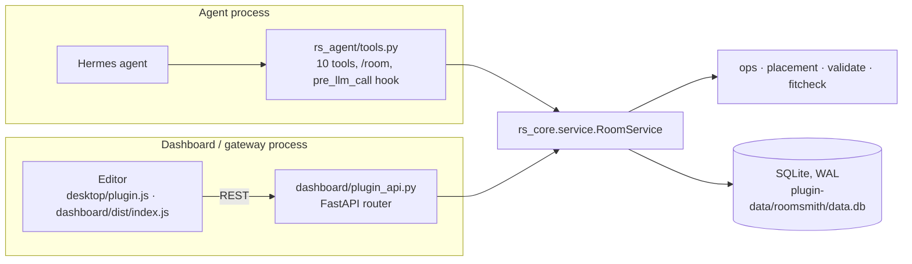

# Architecture

Roomsmith keeps one saved room per project. The agent's tools and the 3D editor
are two clients of the same engine, and every change from either side goes
through one function.



## Layers

| Layer | Files | Rule |
|---|---|---|
| Engine | `rs_core/` | Standard library only. Never imports Hermes. Takes a database path and plain dicts, so the same code runs in the agent process, in the backend process and under pytest |
| Hermes-facing | `__init__.py`, `rs_agent/` | Thin: tool schemas, handlers that call the service and return JSON strings, the photo read through `ctx.llm`, the awareness hook, the data-folder lookup |
| Backend | `dashboard/plugin_api.py` | Thin FastAPI wrappers over the same service. Imported standalone by Hermes, so no relative imports |
| Editor | `web/src/` → two committed bundles | `editor/` is a framework-free three.js core; `ui/` is the React panel; `desktop.tsx` and `dashboard.tsx` are the two shells |

`rs_core/service.py` is the only entry point both clients use. Modules behind it:

| Module | Job |
|---|---|
| `model.py` | Scene shape, defaults, ids, schema version |
| `ops.py` | Every operation as a pure function `scene, op → scene, summary` |
| `placement.py` | Relational placement: against a wall, next to, in a corner, on top of |
| `geometry.py` | 2D polygons, oriented rectangles, distances, overlaps |
| `validate.py` | Hard rules (the command is rejected) and soft issues (reported) |
| `fitcheck.py` | "Does it fit here", "where could it fit", "will it pass the door" |
| `store.py` | SQLite: projects, revisions, command receipts, undo and redo stacks, photos |
| `layout.py` | A model's draft (fractions along walls) → a valid scene, with fallbacks |
| `dims.py`, `catalog.py` | Printed dimensions in cm/mm/m/in/ft → metres; typical sizes per category |
| `product_fetch.py` | Reads one product page the user pasted. The only code that opens a connection |
| `media.py` | Photo type sniffing, product thumbnails |
| `export_glb.py`, `summarize.py` | GLB written with `struct`; text summaries for the agent |

## Two processes, one database

A tool call in a chat and a request from the editor usually run in different
processes. Nothing is shared in memory. The SQLite file under
`<hermes home>/plugin-data/roomsmith/` is the only state.

## The command contract

Every edit, from either side, is a command:

```json
{
  "project_id": "2ef86fc3-…",
  "expected_revision": 7,
  "actor": "agent",
  "operations": [
    { "op": "move_object", "id": "ob1", "place": { "against_wall": "w3", "align": "center" } },
    { "op": "set_dimensions", "id": "ob4", "dimensions_m": [1.2, 0.75, 0.6] }
  ]
}
```

- **Atomic.** All operations apply or none do.
- **Checked against the revision it was based on.** The write runs inside
  `BEGIN IMMEDIATE` and compares `expected_revision` there. A stale command gets
  `revision_conflict` and the current revision; the caller re-reads and retries.
  Neither side can silently overwrite the other.
- **Idempotent.** A repeated command id returns the first result. The tools and
  the backend generate the id; the model never chooses it.
- **Undo and redo are new revisions.** History is never rewritten. Each revision
  stores the whole scene (tens of kilobytes), the actor, a one-line summary and
  the ids it changed. The editor uses those for the toast and the highlight; the
  hook uses them to tell the agent what the user changed by hand.

## How the two sides see each other

- **Editor follows the agent.** The editor long-polls
  `GET /projects/{id}/wait?after=<revision>`. When the revision moves, it fetches
  the scene and animates the difference. When the agent opens another room, the
  poll returns `active_changed` and the editor switches.
- **Agent follows the user.** The `pre_llm_call` hook runs only in sessions that
  have already used a Roomsmith tool, and only when the user has made revisions
  the agent has not seen. It adds two or three lines to that turn's user message
  ("Since revision 12 the user moved Armchair…"). The system prompt is untouched.

## What code decides and what the model decides

The model reads photos and language. Code does geometry. Tools take relations
("against the back wall", "next to ob2") and return coordinates, clearances in
metres and issue codes, so the model quotes numbers instead of estimating them.
Every size carries its source: `measured`, `stated` (printed on a product page)
or `estimated`.

## Boundaries

| | |
|---|---|
| Network | `product_fetch.http_get` only: the URL the user pasted, a Shopify store's public product JSON next to it, and the product's main image. The host and every redirect hop must resolve to public addresses; bodies are capped at 8 MB before and after decompression |
| Model access | `ctx.llm.complete_structured` with the user's active model, read lazily at call time, for photo reading only |
| Files read | Image files the user names or uploads, checked by content, 15 MB cap |
| Files written | Only under `<hermes home>/plugin-data/roomsmith/` (database, photos, thumbnails, `exports/`) |
| Not used | Shell, subprocesses, background threads, environment secrets, tool or model overrides, private Hermes imports |

## Conventions

Metres and radians in the scene; tools speak metres and degrees. Right-handed,
+Y up, floor at Y = 0; an object's front faces −Z at yaw 0. Dimensions are
`[width, height, depth]`. Walls `w1` back, `w2` right, `w3` front, `w4` left, as
seen from the camera that took the photo. Ids (`w1`, `o3`, `ob12`) are never
reused within a project.

## Tests

`tests/` runs the engine, the tools through a recording context that must match
`plugin.yaml`, the backend through FastAPI's test client loaded the way Hermes
loads it, a full demo conversation through the tool layer, and
`tests/test_hardening.py` for the boundaries above. CI also runs Hermes's own
`plugins doctor --ci` and `plugins validate`, and rebuilds both bundles to check
they match the committed files.
